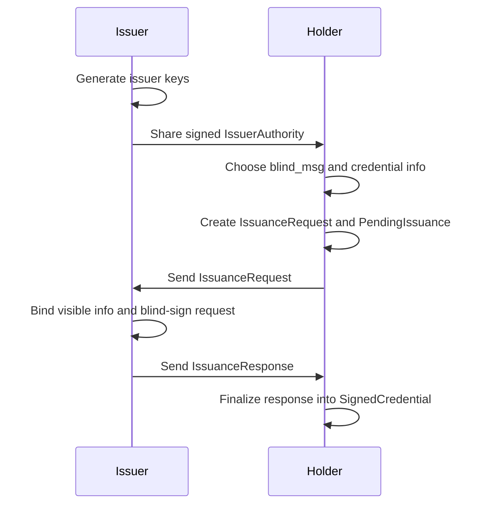
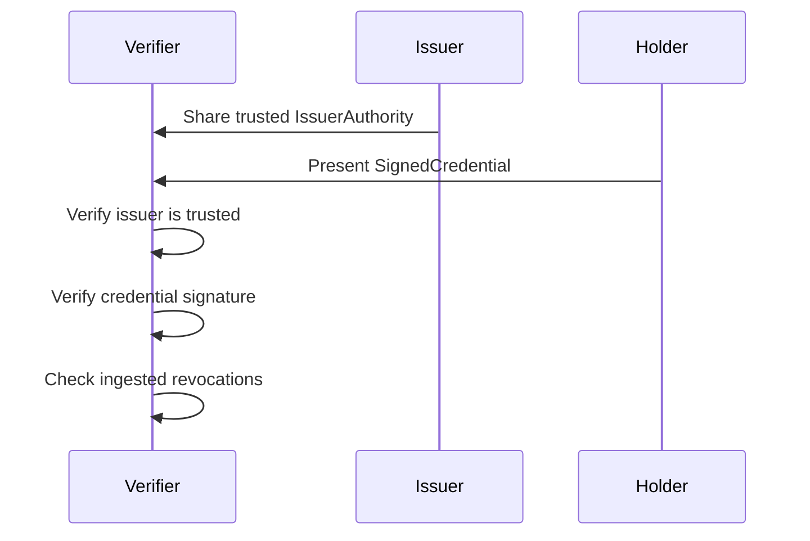
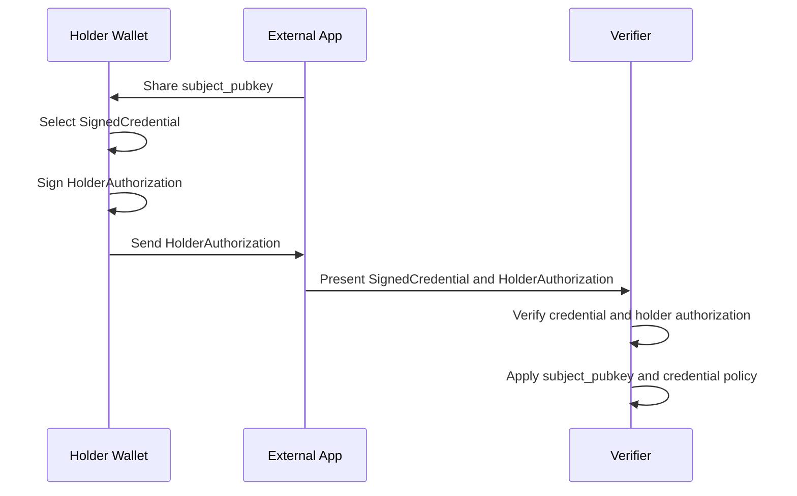
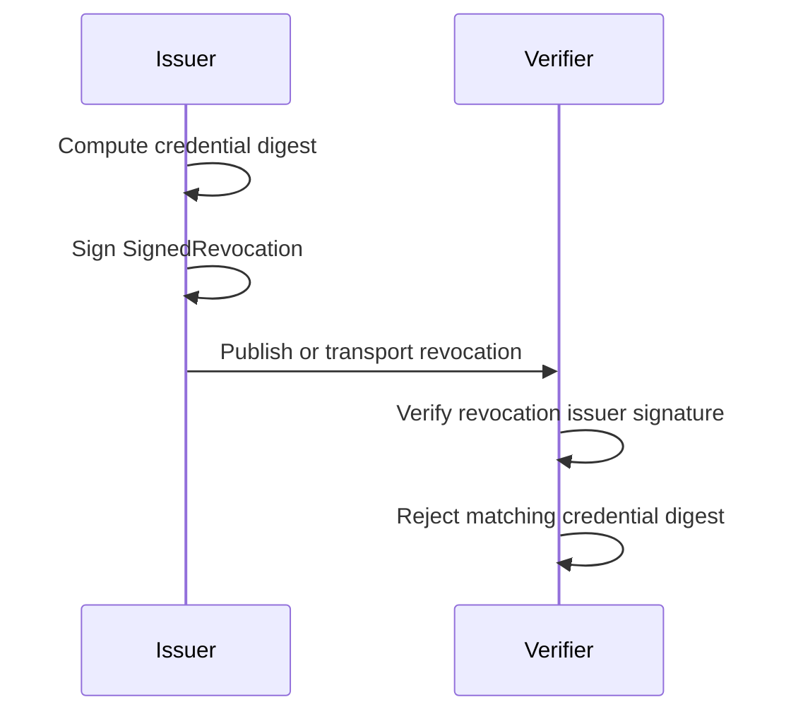
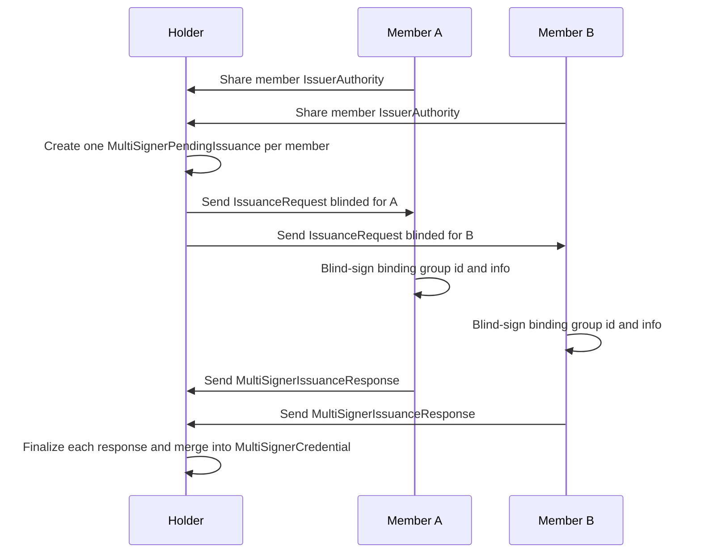
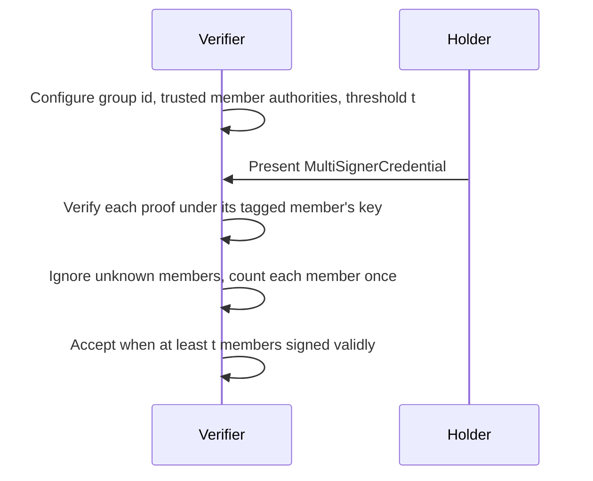

# Protocol Flow

The issuance protocol separates issuer-visible credential information from the
holder-hidden value that is blinded during signing.

## Issuance

## Verification

## Holder Authorization

The SDK signs holder authorizations with the holder identity key and derives
the credential digest from the selected `SignedCredential`. The verifier-side SDK
check verifies the credential, holder authorization signature, holder binding,
authorized credential digest, and authorization issued-at time. Subject-key
proof-of-possession, credential schema policy, storage, and transport stay in
the application.

## Revocation

`credential.info` is visible to the issuer during signing. `credential.blind_msg`
is hidden from the issuer during signing and disclosed in the final credential.

## Multi-Signer Issuance

A multi-signer credential is the same protocol used a different way: several
member issuers each sign one ordinary credential, and verifiers require a
threshold of them. Nothing in the wire format version changes; every object is
still `version: 1`.

- The credential is an ordinary `Credential` whose `issuer_id_pubkey` is a
  **group id**: a fixed Nostr public key that names the group. The group id
  authorizes nothing, signs nothing, and nobody needs its private key. Trust
  comes only from the member issuers that a verifier configures for it.
- Each member is an ordinary issuer with its own `IssuerAuthority`. It signs
  with its own issuance key, but binds the group id instead of its own id into
  the signature, so a member's group signature is never valid as that member's
  own single-issuer credential, and a single-issuer signature never counts for
  the group.
- The holder blinds a separate request for each member, finalizes each response
  into that member's proof, and merges the proofs into one
  `MultiSignerCredential`: the credential plus a list of proofs, each tagged
  with the member issuer id that made it.

The credential digest is computed over the credential payload only, exactly as
for a single-issuer credential. One `HolderAuthorization` therefore covers the
multi-signer credential, and a holder can merge in further member proofs later
without invalidating authorizations it already signed.

Multi-signer issuance suits any case where more than one key should stand
behind a credential, for example:

- **A community with three issuers, any two of which must agree.** The
  community picks a group id and publishes its three issuers' authorities.
  Holders collect two or three member signatures; verifiers configure the group
  with threshold 2. Losing or retiring one issuer does not stop issuance or
  invalidate existing credentials.
- **One issuer that keeps two keys so it can rotate one without reissuing.**
  The issuer runs two member identities under one group id and signs every
  credential with both; verifiers configure threshold 1. To rotate, it
  publishes a new member, verifiers swap the retired member for the new one,
  and existing credentials keep verifying through the remaining key.

What the group and its credentials mean (schemas, levels, which members are
current) stays in `info` and in the verifier's policy.

Revocation of multi-signer credentials is not defined yet; see
[Verification And Revocation](verification-and-revocation.md#multi-signer-credentials).
